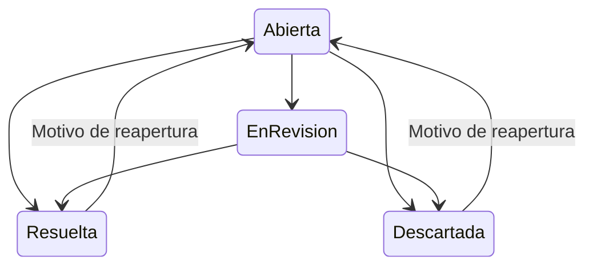

# Alertas: evidencia y seguimiento por proyecto

## Revisar en local

Reinicia el servidor con `ABRIR_NEXO_DESARROLLO_LOCAL.bat`, actualiza http://127.0.0.1:8002 y entra en **Alertas** con tu cuenta local.

- Filtra actor, canal, periodo y estado. El corte predeterminado abarca las 24 horas anteriores a la última hora UTC completa, para que actualizar una vista no cree un corte diferente cada segundo. Se permiten 7 días, 30 días o fechas personalizadas.
- Los indicadores cuentan **incidentes listados** abiertos, en revisión y cerrados, y las reglas esperando datos del corte. Si filtras por estado o llegas al límite de 200 incidentes, los contadores corresponden a esa vista; no pretenden representar todo el histórico.
- **Actualizar vista** consulta sin escribir. Las reglas muestran el resultado calculado del corte: umbral alcanzado, por debajo del umbral, falta de cobertura, falta de periodo anterior o pausa.
- **Evaluar y registrar corte**, disponible a administradores, editores y consultores, conserva los hallazgos que alcancen el umbral. Evaluar de nuevo la misma regla, canal e intervalo no los duplica ni reabre un incidente cerrado.
- Al abrir un incidente aparecen la regla, las cifras, la cobertura de clasificación, el periodo, la huella de evidencia y hasta veinte fuentes conservadas. **Descargar evidencia** exporta ese registro y su historial autorizado.
- **En revisión** inicia la atención. **Resuelta** o **Descartada** requieren motivo. Una cerrada puede reabrirse con motivo. Se conserva cada cambio; el equipo no modifica el hallazgo original.
- Si otra persona guarda antes, se rechaza el cambio desactualizado y se conserva tu nota para que puedas conciliarla. **Recargar estado** pide descartar la nota antes de reemplazarla.
- Solo administradores y editores ven **Crear una regla** y pueden pausar/activar reglas. Se usa el mismo directorio y las mismas reglas de Pulso.

En D14 se conservaron los cuatro actores existentes y no se añadieron reglas, incidentes ni cifras de prueba al proyecto. La primera revisión visual puede hacerse con bandeja vacía. Los casos de activación y cierre se probaron en bases ficticias aisladas.

## Qué se evalúa

| Indicador | Valor y condiciones |
|---|---|
| Volumen de menciones | Número de piezas observadas que mencionan al actor; al menos el mínimo de menciones de la regla |
| Porcentaje negativo | Menciones negativas / menciones con tono clasificado × 100; además del mínimo de la regla, exige el mínimo de clasificación configurado en Pulso |
| Aumento de menciones | (Menciones actuales / menciones del periodo anterior − 1) × 100; requiere un periodo anterior de igual duración con menciones |

Se usa el umbral inclusivo `valor >= umbral`. La fórmula compartida está en `pulse_service.rule_evaluation`: Pulso y Alertas no mantienen dos implementaciones distintas. El aumento puede basarse en un denominador anterior pequeño; se conserva ese denominador para valorar su contexto. No es una prueba de significancia estadística ni de representatividad.

Una señal vigente de Pulso es una condición del corte. Un incidente es un hallazgo registrado con seguimiento. Resolver un incidente no cambia las menciones ni elimina una condición que siga cumpliéndose en otro corte. Los contadores pueden diferir entre ambas pantallas por el periodo, canal, actor y naturaleza del indicador.

El análisis corresponde al **contenido observado**, no al ánimo de toda la población. No se infieren opiniones individuales de votantes. La evaluación no inventa tono ni llama a un modelo: consume las etiquetas ya almacenadas; cuando falta clasificación suficiente, la regla espera datos. La generación automática de esas etiquetas pertenece al circuito de IA pendiente de conexión.

Las menciones se toman de las observaciones normalizadas de Pulso y sus enlaces de actor. Un RSS que solo esté en la biblioteca de noticias no se convierte automáticamente en mención clasificada de un actor: la futura ingestión y análisis deben preparar esa relación y su procedencia.

## Hallazgo e historial

`alert_incidents` conserva regla, proyecto, actor, canal, intervalo y JSON de evidencia con SHA-256. Tiene referencias compuestas que impiden asociar una regla o actor de otro proyecto, y excluye demostraciones. La identidad única es proyecto + regla + canal + inicio + fin.

El primer registro del corte permanece congelado aunque posteriormente cambien las fuentes, las etiquetas o el estado de la regla. No se suman incidentes como si fueran personas o piezas únicas: cortes o canales solapados pueden registrar hallazgos relacionados. Un corte posterior puede producir otro incidente. No se implementó una fusión automática de incidentes relacionados.

`alert_events` agrega cambios con versión, estado anterior, estado siguiente, motivo, autor y fecha. No se actualizan ni eliminan eventos desde la API. Transiciones:



La versión esperada evita sobrescrituras. La API serializa operaciones del proyecto y PostgreSQL añade un trigger con permisos del invocador y bloqueo transaccional del incidente para validar el siguiente paso del historial. No emplea una función con privilegios elevados. La aplicación no puede actualizar ni borrar incidentes o eventos; las dos tablas tienen RLS forzada por membresía.

Los lectores pueden consultar y exportar el proyecto autorizado, pero no evaluar, cambiar estados ni configurar reglas. Un administrador de proyecto no adquiere permisos globales. Las notas del equipo se muestran como texto literal. Al cambiar de proyecto se borran campos, evidencias, historial y permisos y se descartan respuestas tardías. Las notas y reglas sin guardar tienen protección al cambiar de proyecto.

## Archivos y endpoints

- `app/alert_models.py`: hallazgos e historial.
- `app/alert_service.py`: consulta, corte, evidencia y estados; `pulse_service.py` contiene la evaluación compartida.
- `app/alert_api.py`: GET `/api/projects/{pid}/alerts`, GET `/alerts/{alert_id}`, POST `/alerts/evaluate`, POST `/alerts/{alert_id}/reviews`.
- `app/alert_port.py`: protocolo `AlertNotifier` y `DisabledAlertNotifier`, que falla cerrado incluso con tokens en el entorno.
- `static/alerts.js` y sección Alertas del HTML: filtros, reglas, registro, detalle, seguimiento y exportación.
- `migrations/versions/010_alerts.py`: índice único de ámbito en las reglas existentes y dos tablas nuevas, políticas y guardia de historial. Se actualizaron preflight, permisos y exportador SQL de pruebas.
- `tests/test_alerts.py` y `tests/check_alerts_ui.mjs`: reglas, deduplicación, recuperación, roles, proyectos, evidencia congelada, conflictos y protección de pantalla. `tests/rls.pglite.mjs` incluye permisos y secuencia del historial.

No se modificaron `app/main.py` ni `app/knowledge.py`. Se conservaron las filas previas y el mapa territorial.

La evaluación recibe un cuerpo estricto, sin proyecto, usuario, etiquetas ni reglas inyectadas:

```json
{
  "start": "2026-10-19T12:00:00Z",
  "end": "2026-10-20T12:00:00Z",
  "actor_id": 0,
  "network": "all"
}
```

El seguimiento recibe `expected_version`, `status` y `note`. Estados internos: `open`, `acknowledged`, `resolved`, `dismissed`. El servidor fija identidad y proyecto a partir de la sesión y membresía.

Límites: 48 intentos de evaluación y 100 de seguimiento por proyecto/día UTC; 10.000 incidentes por proyecto antes de revisar conservación; 100 reglas por proyecto según el límite existente de Pulso; consulta de 200 incidentes con indicador explícito al acotarse; 100 actores para el selector; 20 fuentes de evidencia; últimos 100 eventos en detalle y hasta 1.000 versiones por incidente; notas de 1.000 caracteres. El rango es de un minuto a 90 días, con zona horaria y sin fin futuro. Los intentos consumen cuota aunque fallen.

La muestra de fuentes no es el denominador completo. Para porcentaje negativo muestra piezas negativas; para las demás reglas, piezas del actor dentro del corte. Se conservan títulos, enlaces, canal y fechas; no se guardan perfiles individuales de audiencia en este módulo.

## Activación futura

El trabajo es local. No se configuraron reglas de D14 en nombre del usuario, se enviaron mensajes, conectaron proveedores ni generaron gastos. Los valores y umbrales reales deben acordarse cuando existan cobertura y muestras del proveedor.

La frontera del notificador declara proyecto, incidente, huella, canal y clave de idempotencia; no constituye un envío ni una cola de entrega implementada. Antes de activarla faltan adaptador autorizado, destinos y preferencias, secretos fuera del cliente, límites de frecuencia, agrupación de incidentes, reintentos, entrega idempotente, auditoría y monitoreo. No enviar automáticamente el contenido privado de notas operativas; definir una plantilla con acceso autorizado y datos mínimos.

También faltan el trabajador periódico y la política de cortes/solapamientos para evaluación automática, confirmar clasificación y atribución de actores desde fuentes reales y probar todo en PostgreSQL nativo y un entorno separado antes de migrar la nube. No se promete que agregar una clave de API complete estos pasos.

## Pruebas y respaldo

Las cifras finales están en `ALERTAS_RESULTADO.json`. Las pruebas SQL usan PostgreSQL en WASM (PGlite), sin validar red, TLS, pooling ni servidor nativo. Las pruebas JS usan DOM simulado; la revisión visual corresponde al usuario en su navegador local.

La migración aditiva 010 se ensayó dos veces en una copia antes de aplicarse localmente. Se verificaron las huellas de todas las filas previas y el mismo SVG territorial. Hubo respaldo cifrado DPAPI antes y después con restauración aislada. Depende del usuario Windows actual y no es un respaldo externo ni portable a otra computadora. El paquete editable no incluye claves, bases ni copias privadas.

Tras aceptar Alertas, sigue **Explorador**.

Aceptación visual del usuario: «Sí, aparece todo y se entiende». Continúa Explorador; fuentes externas pendientes.
