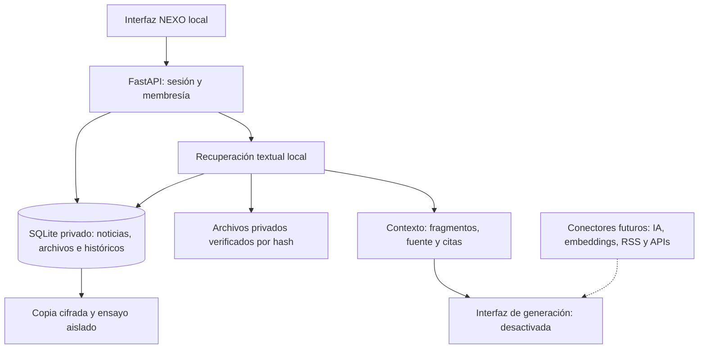

> **Política y diseño vigentes — 21 de octubre de 2026:** solo el superadministrador gestiona. Todas las demás cuentas consultan sus proyectos, buscan y descargan recursos autorizados; no cargan, guardan, publican ni configuran. La regla se aplica en el servidor local y oculta borradores. Interfaz compacta y adaptable, desplegables propios, sin «Vista simplificada», «Otro» de Pulso o botón de demostración. La muestra ficticia se abre con PROBAR_NEXO_DISENO.bat (8003); el piloto conserva 8002. 625 pruebas Python y 255 comprobaciones JS aprobadas. Falta revisión visual humana. Ver NEXO_DISENO_CONSULTA_GUIA.md o docs/DISENO_CONSULTA.md. Las referencias inferiores a roles editores/analistas pertenecen al historial y no conceden escritura actual. Nube y proveedores no se modificaron.

> **Versión preparada para prueba general local:** evaluación de recuperación implementada; 23 casos de los archivos reales aprobados, incluidos los dos que detectaron falsas coincidencias. Regresión amplia: 585 pruebas Python; revisión final del evaluador/comprobador: 29 pruebas, con solapamiento y sin sumar ejecuciones. 239 comprobaciones de controladores JS. Respaldo restaurado con las 23 búsquedas y el informe versión 2 conservados. Falta la aceptación general de uso en navegador. Sigue `docs/PRUEBA_GENERAL_LOCAL.md`; APIs, IA y producción no se consideran validadas. El contenido inferior conserva el historial.

> **Estado vigente — Biblioteca con PDF:** los PDF con texto se preparan al cargar; los archivos anteriores tienen una acción directa de preparación. Biblioteca muestra los originales, permite elegir un documento, buscar solo en él y leer su texto por página. Las citas y los nuevos informes conservan ese alcance. Los dos PDF aportados ya tienen texto preparado y búsquedas comprobadas. 127 pruebas Python del bloque afectado y 230 comprobaciones JS aprobadas; revisión visual pendiente. Todo sigue local. PDF sin texto necesita OCR. Guía `docs/BIBLIOTECA_PDF.md`. El contenido inferior conserva el historial de avances.

> **Validación vigente:** el usuario confirmó que la consulta «sección 158» presenta una ficha clara y correcta, con PRIMO VERDAD INEGI y lista nominal 438, dejando el origen en el detalle desplegable. Se conserva la evidencia de 499 pruebas Python y 212 comprobaciones JS; esta confirmación corresponde a la revisión humana de esa consulta. Próximo bloque: extracción de PDF y citas por página con un documento representativo. Todo continúa local.

> **Estado vigente — Biblioteca por registro:** corregida la consulta que mezclaba filas de Excel y exponía metadatos en la ficha. Ahora «sección 158» devuelve únicamente su registro, con campos legibles y origen desplegable; los nuevos informes usan la misma selección. 499 Python y 212 JS aprobadas, consulta real y restaurada comprobadas. Sin cambios en datos, tablas, mapa, archivos protegidos o nube. Revisión visual pendiente. Guía `docs/EVIDENCIA_POR_REGISTRO.md`. El texto inferior conserva el historial.

> **Estado vigente — Biblioteca Excel, 20/10/2026:** extracción local por selección de hoja/filas/columnas, referencias a celdas y copia textual buscable. El Excel del usuario se incorporó solo al D14 con año 2024 declarado y fuente externa pendiente: 45 registros, lista nominal 65,441 frente a 65,378 conservados; diferencia 63, sin sustituir el histórico. 480 Python, 198 JS y recuperación aislada aprobadas. Sin tablas nuevas (34), con archivos protegidos y mapa intactos. Revisión de búsqueda en pantalla pendiente. PDF y generación siguen pendientes; sin conexiones ni gastos. Guía `docs/BIBLIOTECA_EXCEL.md`. El texto inferior conserva el historial.

> **Estado vigente — recorrido básico por roles aceptado:** el usuario confirmó consola global, creación/asignación de consultor al D14, inicio de sesión limitado, cuatro actores sin gestión y lectura del informe con fuentes. Hay 29 pruebas adicionales de roles y la regresión anterior de 420 Python y 184 JS. El siguiente bloque local es Biblioteca/evidencia: extracción PDF/XLSX y evaluación documental para RAG. Trabajadores y adaptadores reales siguen pendientes; matriz editable `docs/MATRIZ_CONEXIONES_LOCAL.csv` y guía `docs/CIERRE_LOCAL_Y_SIGUIENTE_BLOQUE.md`. No se conectaron fuentes ni se cambiaron permisos. El texto inferior conserva el historial.

> **Estado vigente — recorridos por rol, 20/10/2026:** Auditoría de cuentas aceptada por el usuario tras el ajuste de visibilidad. Aprobadas 29 pruebas adicionales de experiencia por proyecto y rol, con cuentas sintéticas y bases aisladas. Se conserva la regresión anterior de 420 Python y 184 JS, sin cambios de código funcional. La copia real tiene una cuenta activa con administración global de dos proyectos; falta una cuenta de consultor para aceptación manual. No se crearon ni reactivaron cuentas reales ni se cambiaron sus permisos. Guía `docs/VALIDACION_ROLES.md` (outputs: NEXO_VALIDACION_ROLES_GUIA.md). Sin conexiones ni gastos. Debajo se conserva el historial.

> **Ajuste vigente de Auditoría de cuentas:** botón superior «Ver diagnóstico en pantalla» y botones por cuenta; mensaje de primera captura pendiente siempre visible; descarga rotulada «Descargar datos (JSON)». 184 comprobaciones de controladores y 2 verificaciones estáticas aprobadas. Backend, datos y esquema sin cambios; se conserva la regresión previa de 420 pruebas. El usuario confirmó la URL local y reportó dificultad para encontrar el diagnóstico; aceptación visual pendiente tras este ajuste. Reiniciar y actualizar con Ctrl+F5. Guía `docs/AUDITORIA_CUENTAS.md`.

> **Estado vigente — Auditoría de cuentas, 20/10/2026:** referencias por proyecto, fechas, campos y periodos de capturas; filtros y diagnóstico JSON de solo lectura. 420 pruebas Python y 179 de controladores JS aprobadas. Se conserva la base de 159 comprobaciones SQL WASM previas, con esquema y políticas sin cambios. Reportes y su descarga HTML aceptados por el usuario. Mismas 34 tablas y migración 010; datos y mapa preservados. Sin conexiones, gastos ni capturas ficticias. Pendiente revisar visualmente Auditoría de cuentas. Guía `docs/AUDITORIA_CUENTAS.md` (outputs: NEXO_AUDITORIA_CUENTAS_GUIA.md). Lo que sigue conserva el historial.

> **Estado vigente — Reportes, 20/10/2026:** archivo con tipos/estados, versiones y lectura autorizada; JSON y documento HTML imprimible desde la copia guardada. 383 pruebas Python, 159 SQL WASM y 161 de controladores JS aprobadas. Mismas 34 tablas y migración 010. Datos y mapa preservados; Explorador aceptado por el usuario. Sin conexiones, gastos ni informes ficticios añadidos al D14. Revisión visual y descarga de Reportes pendientes; sigue Auditoría de cuentas. Guía `docs/REPORTES.md` (en outputs: NEXO_REPORTES_GUIA.md). El texto inferior conserva el historial.

> **Estado vigente — Explorador, 20/10/2026:** archivo unificado por proyecto, filtros y detalle con fecha y fuente, selección explícita de hasta ocho evidencias e informe congelado en Reportes. 368 pruebas Python, 159 SQL WASM y 142 de controladores JS aprobadas. Sin cambios de esquema: 34 tablas, migración 010. Datos y mapa preservados, Alertas aceptadas por el usuario. Sin conexiones, gastos ni fuentes ficticias añadidas. Explorador aceptado visualmente por el usuario; sigue Reportes. Guía `docs/EXPLORADOR.md` (en outputs: NEXO_EXPLORADOR_GUIA.md). El texto inferior conserva el historial.

> **Estado vigente — Alertas, 20/10/2026:** bandeja por proyecto, reglas compartidas con Pulso, evidencia congelada y seguimiento con versiones. 341 pruebas Python, 159 SQL WASM y 124 de controladores JS aprobadas. Migración local aditiva 010; 34 tablas, filas previas y mapa preservados. Fidelidad aceptada por el usuario. Sin conexiones, envíos, gastos ni datos ficticios añadidos al D14. Alertas aceptadas visualmente por el usuario; sigue Explorador. Guía `docs/ALERTAS.md` (en outputs: NEXO_ALERTAS_GUIA.md). El texto inferior conserva el historial.

> **Estado vigente — Fidelidad, 20/10/2026:** continuidad agregada por cuenta y periodo, retorno y retención con bases explícitas, evolución y comparación. 310 pruebas Python de regresión y 1 adicional de recuperación; 134 SQL WASM y 107 de controladores JS aprobadas. Migración local aditiva 009; 32 tablas, filas y mapa preservados. Sin conexiones, gastos ni cifras ficticias añadidas al D14. Fidelidad aceptada visualmente por el usuario; sigue Alertas. Guía `docs/FIDELIDAD.md` (en outputs: NEXO_FIDELIDAD_GUIA.md). El texto inferior conserva el historial.

> **Estado vigente — Redes, 20/10/2026:** panel por actor, red, cuenta y periodo; evolución observada, comparación y carga local de capturas implementados. 271 pruebas Python, 119 comprobaciones SQL WASM y 92 de controladores JS aprobadas. Sin capturas ficticias en D14, conexiones ni gastos nuevos; interfaz aceptada por el usuario. Misma migración 008 y 31 tablas. Guía `docs/REDES.md` (en outputs: NEXO_REDES_GUIA.md). El texto inferior conserva el historial.

> **Estado vigente — Territorio, 20/10/2026:** se reutiliza la vista validada sin reconstruir el mapa ni los datos. 45 secciones y 721 manzanas conservadas; limpieza de proyecto y exportaciones tardías comprobadas. 17 pruebas Python dirigidas y 75 comprobaciones de controladores JS aprobadas; backend y políticas sin cambios. Guía `docs/TERRITORIO.md`. Próxima revisión: Redes.

> **Estado vigente — Actores, 20/10/2026:** fichas públicas propias por proyecto, referencias de cuentas, búsqueda, archivo y cambio atómico del principal implementados en local. 231 pruebas Python, 119 comprobaciones SQL WASM y 61 de controladores JS aprobadas. 31 tablas; migración futura 008. Revisión visual pendiente. Sin conexiones ni gastos nuevos. Guía: `docs/ACTORES.md` (en outputs: NEXO_ACTORES_GUIA.md). El texto inferior conserva el historial.

> **Estado vigente — Briefing y análisis de contenido, 20/10/2026:** circuito de IA local preparado, corrección opcional, modelo sin conectar. 206 pruebas Python, 106 comprobaciones SQL WASM y 44 comprobaciones de controladores JS aprobadas. 30 tablas; migración futura 007. Sin llamadas de IA, envíos ni gastos. Guía vigente: `docs/ANALISIS_IA.md` (en outputs: NEXO_ANALISIS_IA_GUIA.md). El texto inferior conserva el historial.

> **Estado vigente — Ampliación de Briefing, 20/10/2026:** lectura, guardado y habilitación base aceptados. Métricas por pieza, programación privada y bandeja de simulación implementadas; nuevos controles pendientes de aceptación visual. 180 pruebas Python y 92 SQL WASM aprobadas; 29 tablas, migración futura 006. Envíos y programador automático desconectados. WhatsApp Business Platform no admite este uso político. Guía vigente: `docs/ENVIO_BRIEFING.md` (en outputs: NEXO_ENVIO_BRIEFING_GUIA.md). El texto inferior conserva el historial.

> **Entrega vigente — Briefing, 20/10/2026:** Pulso aceptado visualmente. Briefing ahora reúne un corte documental por proyecto y guarda borradores con cifras y fuentes congeladas. 156 pruebas Python y 11 comprobaciones del controlador de Briefing aprobadas; aceptación de esta pantalla pendiente. No hubo nuevas tablas ni cambios de nube. Consulta `docs/BRIEFING.md` (en outputs: NEXO_BRIEFING_GUIA.md). El texto inferior conserva el historial de entregas.

> **Estado vigente, 20/10/2026:** Pulso, marca editable y superadministración local agregados; 26 tablas, migración futura 005, 134 pruebas Python y 73 SQL WASM aprobadas. Consulta `docs/PULSO_Y_PROYECTOS.md` y `docs/HOJA_RUTA_MAESTRA.md` (en outputs: NEXO_PULSO_Y_PROYECTOS_GUIA.md). Las secciones inferiores conservan el historial de entregas y sus resultados de aquella fecha. `main.py` y `knowledge.py` siguen intactos. Nube y proveedores externos sin cambios; validación visual nueva pendiente.

# nexo. · Construir en local, conectar al final

19 de octubre de 2026 · Piloto D14 · Presupuesto autorizado USD 0 / MXN 0

La decisión de trabajo es desarrollar y aceptar las funciones en esta computadora. Las conexiones de nube, IA, extracción y mensajería se integrarán después mediante interfaces separadas. La arquitectura reduce el trabajo repetido; no convierte las autorizaciones y pruebas finales en un trámite garantizado de un día.

**Última entrega: informes persistentes y navegación de consulta.** Inicio Resumen; Explorar, Territorio, Informes y Fuentes. Los informes conservan fuentes y versiones; admin/editor habilitan lectura y viewer consulta únicamente las versiones habilitadas dentro de este módulo. Tres tablas nuevas, 17 en total, migración futura 004 y 90 pruebas Python / 48 comprobaciones SQL WASM aprobadas. `main.py` y `knowledge.py` siguen intactos. Guía: `NEXO_INFORMES_GUIA.md`; alcance completo y pendientes: `NEXO_HOJA_RUTA_MAESTRA.md`. No se desplegó en nube y falta aceptación visual del recorrido.

## Qué contiene realmente el ZIP de Atalaya

`Atalaya_proyecto_web.zip`, 66,362 bytes; SHA-256 `3c700b932d3def745b9d07e1a6db8155fb0c1fed0a8b6266751c585482d3aa95`.

Incluye README, una maqueta HTML/CSS/JavaScript con once secciones, un motor de plantillas propio y dos documentos Markdown. No incluye servidor, base de datos, migraciones, autenticación operativa ni el CSV original de los comentarios. Su README identifica los datos como ejemplos y los cambios como temporales en memoria. No se encontraron dependencias de paquetes o llamadas de API en el código de la maqueta; las tipografías de su HTML original dependen de Google Fonts.

Se revisaron los archivos como material de referencia. Las frases del documento dirigidas a otro desarrollador y las etiquetas «DECIDIDO» no sustituyen tu solicitud actual. No se ejecutó el ZIP como instalador ni se incorporaron sus arreglos de datos ficticios al archivo real de NEXO.

| Aporte | Decisión para NEXO |
|---|---|
| Navegación, filtros, explorador y briefing | Reutilizar la organización; filtros y resumen documental ya existen en la base integrada |
| Configuración de temas y revisión de clasificaciones | Siguiente módulo local; requiere persistencia, permisos y registro de cambios |
| Reportes con procedencia | Preparar a partir de registros reales y correcciones revisadas |
| Gráficos de emociones, tono y supuestos volúmenes | Mantener como ejemplos; necesitan datos y evaluación antes de operar |
| Fórmulas y decisiones de proveedor | Referencia de diseño; no son precios vigentes ni autorización de gasto |
| Perfiles de fidelidad política y rankings personales | Fuera de esta integración; trabajar con contenidos y conteos agregados |

Actualización del nuevo HTML: navegación Atalaya y ficha documental de extractos con citas integradas, conservando la biblioteca y revisión manual. No se activaron modelos, caché ni ingesta social. Las rutas recibidas se adaptaron al contrato actual sin cambiar `main.py`, `knowledge.py` ni `models.py`. Guía y alcance: `NEXO_INTEGRACION_HTML_GUIA.md`; resultado: `NEXO_INTEGRACION_HTML_RESULTADO.json`. La nueva comprobación reúne 64 pruebas Python aprobadas y sintaxis JavaScript; falta la aceptación visual del nuevo diseño.

Segunda entrega de interfaz: `NEXO_INTERFAZ_2_GUIA.md`. Se integró la distribución del nuevo candidato con estados coherentes, mapa completo, revisión manual y espacio de reportes marcado como pendiente. Todo el servidor permanece intacto; última ejecución de 65 pruebas Python aprobada. La aceptación visual sigue pendiente y el guardado versionado de reportes continúa como próximo bloque local.

## Estructura preparada

La UI no contiene claves de proveedor. FastAPI valida identidad y proyecto antes de acceder a noticias o documentos. La recuperación usa los modelos existentes de SQLAlchemy. La capa de revisión añade cuatro tablas de temas, revisiones, asignaciones e historial; no cambia los datos históricos. Las interfaces de generación están en `app/integration_ports.py`; no incluyen SDK ni conexión activa. El endpoint de respuestas devuelve un error explícito de función desactivada.

| Capa | Disponible ahora | Preparación para la fase final |
|---|---|---|
| Datos | SQLite privado; 20 noticias y 45 secciones copiadas del local habitual | PostgreSQL con las migraciones y RLS existentes; repetir aceptación con la versión final |
| Acceso | Cuenta local y membresía de proyecto | Autenticación de nube y MFA, ya disponibles en staging; validar sesiones y revocación al publicar |
| Biblioteca | TXT/MD UTF-8 hasta 512 KiB y CSV; hash verificado | Extractores PDF/XLSX, versiones y evaluación de cobertura pendientes |
| Recuperación | Coincidencias textuales, fragmentos y citas; sin inferencia | Embeddings/índice y recuperación semántica sujetos a pruebas de calidad y aislamiento |
| Generación | Contrato definido, implementación desactivada | Elegir modelo, límites de consumo, política de datos y validación de citas |
| Fuentes | Archivo guardado y carga manual | Un adaptador autorizado por API, con deduplicación, reintentos y cuota |
| Operación | Copia cifrada local y recuperación aislada comprobadas | Copia externa y recuperación completa antes de publicar |

Este trabajo no reescribe NEXO en Next.js: el ZIP de Atalaya no contiene un frontend de React que obligue a hacerlo. Mantener FastAPI y la interfaz existente reduce cambios de herramientas. Las decisiones de proveedor se tomarán cuando exista una necesidad concreta de conexión.

## Uso de la copia local

Abre `ABRIR_NEXO_DESARROLLO_LOCAL.bat`. Entra en `http://127.0.0.1:8002` con tu cuenta LOCAL habitual. La ventana del servidor debe permanecer abierta; Ctrl+C detiene solo esta copia. La pantalla inicial es «Biblioteca y evidencia».

La primera ejecución crea un snapshot privado en `work/private/nexo-local-workspace/workspace.sqlite`. Las ejecuciones siguientes conservan ese archivo y sus cambios. No se sincroniza automáticamente con los puertos 8000/8001 ni con la nube. La fuente local original permanece intacta. La clave de sesión y los archivos cargados están fuera del código; el directorio privado tiene permisos Windows del usuario y SYSTEM.

Puedes registrar TXT/MD/CSV en «Fuentes y archivos» y buscarlos en la biblioteca. Los fragmentos contienen un identificador de cita, nombre de archivo o medio, enlace cuando existe y hash del fragmento. La descarga conserva ese contexto en JSON. No se genera una explicación ficticia cuando no hay resultados.

La búsqueda revisa hasta 200 noticias recientes y 20 documentos, con máximo 400 candidatos y ocho resultados. Cada documento tiene límite de 40,000 caracteres para la consulta; CSV hasta 500 filas y 30 columnas. Se declara la cobertura limitada y los archivos no procesados. PDF/XLSX siguen almacenables, pero su contenido no se extrae en esta versión. No hay índice vectorial ni RAG generativo activo.

RSS externo está bloqueado antes de consultar DNS; IA y conectores están desactivados. La UI no solicita claves de proveedores. Los documentos son datos no confiables: su texto no activa herramientas ni modifica instrucciones. Los enlaces a fuentes se abren únicamente por acción del usuario.

## Copias de seguridad

`RESPALDAR_NEXO_DESARROLLO_LOCAL.bat` crea una copia cifrada DPAPI de esta copia de desarrollo y comprueba una recuperación en otra carpeta. Incluye base, clave de sesión y archivos referenciados; nunca sobrescribe la base activa. Resultado: `NEXO_LOCAL_RESPALDO_RESULTADO.json`.

DPAPI depende del perfil Windows y normalmente de esta computadora. No equivale a un respaldo externo recuperable si se pierde el equipo. La carpeta privada de Drive preparada antes sigue sin una copia de nube. La prueba ficticia PostgreSQL pasó según el usuario y el reporte local; la exportación real de Supabase y la recuperación de Auth/MFA no se han completado. Con la nueva prioridad local no hace falta introducir la contraseña de Supabase.

## Secuencia de desarrollo

1. **Disponible:** base local integrada, biblioteca textual con citas, inventario de conexiones apagadas y copia cifrada comprobada.
2. **Implementado:** catálogo manual de temas, etiquetas por pieza, corrección e historial de cambios. Quince pruebas del módulo y su actualización de esquema aprobadas; pantalla visible confirmada por el usuario. Falta la aceptación humana del flujo completo de guardar una revisión e historial.
3. **Siguiente:** resumen guardado y reportes, indicadores con denominadores y cobertura, pruebas con datos faltantes y sin resultados. La opinión poblacional no se infiere de una selección de publicaciones.
4. **Preparar la futura IA:** conjunto de preguntas/respuestas esperadas, citas obligatorias, abstención, fuentes contradictorias y documentos con instrucciones maliciosas. Definir el presupuesto antes de conectar un modelo.
5. **Conexión final:** una API por vez; ensayar en staging y aceptar cada integración antes de ampliar fuentes o usuarios.

## Jornada de conexión final: criterios de entrada

Podemos reservar una jornada de integración cuando el producto local ya esté aceptado, las cuentas y permisos estén disponibles y los adaptadores hayan sido probados. No se garantiza que aprobaciones de APIs, límites del proveedor, carga de documentos o reconstrucción de índices terminen ese día.

- Código congelado, dependencias fijadas, pruebas y migraciones aprobadas.
- Fuentes autorizadas y contratos reales de datos; permisos de lectura mínimos.
- Presupuesto explícito y corte de consumo por proyecto; reintentos y errores no disparan gasto sin control.
- Secretos introducidos en el proveedor, nunca en el navegador o repositorio.
- PostgreSQL, RLS, MFA y pruebas de aislamiento/revocación con la versión final.
- Exportación cifrada, restauración en entorno separado y custodia externa de la clave.
- Evaluación de recuperación/citas y abstención antes de aceptar respuestas de IA.
- HTTPS, monitoreo, límites y posibilidad de volver a la versión anterior.

El código local no se publicó ni se desplegó en esta etapa. Los servicios gratuitos existentes se conservaron sin cambios; el flujo de desarrollo actual no los consulta ni activa planes de pago. Los costos de trabajo y herramientas no desaparecen por desarrollar en local: este cambio reduce conexiones, despliegues y dependencias externas repetidas.

## Actualización: temas y revisión

El módulo está implementado en la copia local del puerto 8002; el usuario confirmó que aparece. La base conserva veinte noticias y las 45 secciones. Se observaron temas guardados sin importar datos de ejemplo. Guía de uso y alcance: `NEXO_TEMAS_REVISION_GUIA.md`; pruebas y limitaciones: `NEXO_TEMAS_REVISION_RESULTADO.json`. La nueva migración de catorce tablas protegidas se probó como SQL en PostgreSQL WASM 18.6; no se aplicó a Supabase y necesita aceptación sobre su versión nativa antes de publicar.
