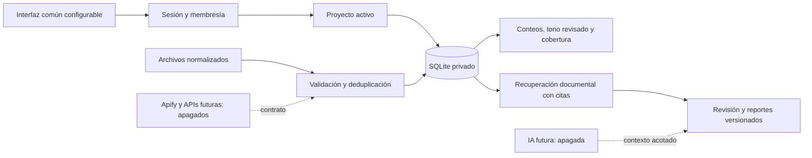

# NEXO · Arquitectura y hoja de ruta vigente

20 de octubre de 2026 · Desarrollo local. Guía detallada: **PULSO_Y_PROYECTOS.md**. BRÚJULA inspira la lectura; Atalaya aporta el catálogo; la marca NEXO es editable.

## Unidad de operación

La plataforma contiene proyectos independientes. Cada proyecto reúne todas sus pestañas, datos, actores públicos, territorio, fuentes, capturas, revisiones, reglas e informes. Las cuentas del cliente reciben membresías explícitas. El propietario de plataforma accede a todos los proyectos activos con membresías administrativas auditadas. Un admin de proyecto no obtiene permisos globales.

La marca se almacena separada de proyectos y usuarios. El servidor conserva una única dependencia de autorización por proyecto para módulos anteriores y nuevos. Los identificadores de proyecto se fijan en cada consulta; al cambiar, se limpian resultados, formularios y respuestas tardías.

## Estado por bloque

| Bloque | Disponible localmente | Pendiente |
|---|---|---|
| Marca y plataforma | Marca editable, cuentas, proyectos y membresías, concesión local explícita | Servicio administrativo seguro de nube; altas/invitaciones y recuperación de acceso en proveedor |
| Pulso | Filtros, corpus por actor, cobertura, comparaciones, emociones revisadas, reglas y capturas | Conectar fuentes, evaluar clasificador, cuotas acumuladas, retención y series más amplias |
| Briefing | Base aceptada. Métricas de piezas, nota editorial, programación privada y simulaciones locales | Aceptar ampliación; trabajador de preparación y envío, proveedor y revisión final |
| Actores / Redes | Fichas y cuentas por proyecto; Redes con corte, evolución, comparación e importación inmutable; recorrido aceptado | Adaptadores reales, permisos, definiciones de métricas y presupuestos |
| Territorio | Histórico y mapa D14 preservados; otros proyectos vacíos | Configuración de distintos mapas, años y conjuntos por cliente |
| Fidelidad | Continuidad agregada por cuenta y medición, retorno y retención; recorrido aceptado | Fuente de cortes agregados con periodos y definiciones estables |
| Alertas | Reglas y evaluación del corte; incidentes, evidencia congelada y estados versionados; recorrido aceptado | Datos reales y notificaciones autorizadas |
| Explorador y revisión | Archivo, filtros, detalle, selección para informe congelado; recorrido aceptado | Cobertura y mapeos de otras fuentes |
| Reportes | Versiones, habilitación por rol, filtros, JSON y HTML imprimible; pantalla y descarga aceptadas | Prueba de impresión/PDF en equipo del usuario y envíos autorizados |
| Auditoría de cuentas | Referencias con o sin capturas; calidad de campos, fechas, origen y alineación de cortes; JSON | Recorrido visual aceptado; contratos reales de fuente pendientes |
| Biblioteca / RAG | TXT/MD/CSV y selecciones XLSX con origen/celdas; búsqueda textual, hashes y citas | PDF/OCR, evaluación, embeddings y generación con evidencia |
| Operación | Respaldo DPAPI y restauración aislada; auditoría; límites por lote | Respaldo externo independiente del equipo, monitoreo, retención y cuotas por cliente |
| Publicación | Migraciones 001–010 y políticas preparadas (34 tablas) | PostgreSQL nativo, MFA, TLS, control administrativo, secretos, costos y aceptación final |

## Límites de interpretación

Tono y emociones describen contenido público observado y clasificado, no opiniones de una población. La parte de conversación usa solo el corpus monitoreado. Las vistas no son personas únicas. Sin cobertura suficiente se muestra «sin dato». Las demostraciones son explícitas y están separadas mediante claves compuestas.

RAG podrá organizar evidencia y contradicciones con citas y revisión humana. No se construyen perfiles de preferencias políticas individuales ni grupos sintéticos para optimizar persuasión dirigida a electores.

## Orden de trabajo

1. Recorrido básico de pantallas y cuentas locales revisado; consola global y consultor D14 aceptados. Mantener los permisos y la separación por proyecto.
2. Ampliar Biblioteca con extracción PDF/XLSX y evaluación de recuperación documental; completar trabajadores y contratos específicos pendientes sin conexión externa.
3. Evaluar contratos reales de una fuente por vez, fixtures de errores, cobertura, deduplicación, cuotas, retención y revisión de etiquetas. Seguir sin conexiones externas.
4. Con autorización final, conectar proveedor, identidad de nube y APIs. Ejecutar migraciones y pruebas nativas, restauración externa, TLS, monitoreo y aceptación con roles.

El primer cliente D14 podrá pasar de piloto a operación tras esas validaciones. Los demás proyectos reutilizarán funciones y cargarán su propia configuración e información. No se garantiza una única jornada de conexión ni se declara completa la aplicación.

Ampliación vigente: `ENVIO_BRIEFING.md`. Programación individual por proyecto, destino cifrado y simulaciones sin red. WhatsApp no disponible por política del proveedor para este uso. La conexión final requiere proveedor permitido, verificación de destinatario, secretos, trabajador, permisos y transición controlada de la bandeja.

Circuito de análisis IA preparado en local: `ANALISIS_IA.md`. Las emociones, el tono y la burla se recibirán del modelo validado. La revisión humana es opcional; no se presenta un clasificador por palabras como IA. El proveedor, trabajador y evaluación siguen pendientes de la fase final.

Actores: fichas públicas y cuentas de referencia implementadas; permisos y regresión aprobados. Guía `ACTORES.md`. Revisar visualmente y configurar datos elegidos por el usuario; después continuar con Territorio. Las referencias no activan por sí solas Apify ni recuperan estadísticas.

Territorio: se reutiliza la vista previamente validada por indicación del usuario. Mismo mapa, 45 secciones y 721 manzanas; sin cambios de datos ni backend. Cambios de proyecto y exportaciones tardías comprobados. Siguiente revisión: Redes. Guía `TERRITORIO.md`.

Redes: implementada y probada en local, con referencias existentes, métricas por periodo y procedencia, sin sumar audiencias ni tratar menciones como publicaciones propias. Guía `REDES.md`. Revisar visualmente; el siguiente bloque es Fidelidad, cuya definición debe mantenerse agregada y sin perfiles políticos individuales.

Redes: el usuario confirmó que aparecen las referencias, los filtros y el comparativo y que se entiende el recorrido. Interfaz aceptada. La siguiente pantalla, Fidelidad, requiere elegir su definición agregada; se ha propuesto continuidad de audiencia. No hay autorización nueva de conexión externa.

Fidelidad: el usuario aprobó continuidad de audiencia agregada. Pantalla y estructura local implementadas con corte por cuenta, fuente y medición; retorno y retención con denominadores distintos; reserva de muestras pequeñas; historial inmutable y permisos. Migración 009 aplicada solo local tras ensayo y respaldo. 310 pruebas Python de regresión y una adicional de recuperación, 134 SQL WASM y 107 JS aprobadas. API y proveedor permanecen desconectados; validar disponibilidad real de participantes únicos e intersección agregada antes de conectarlos. Guía `FIDELIDAD.md`. Falta aceptación visual y después sigue Alertas.

Fidelidad fue aceptada visualmente por el usuario. Alertas implementa una bandeja por proyecto con corte y estados, evaluación compartida con Pulso, evidencia congelada, deduplicación e historial con control de versión. Migración 010 aplicada solo local después de ensayo y respaldo. 341 Python, 159 SQL WASM y 124 JS aprobadas. Sin nuevas reglas ni incidentes de prueba en D14. Fuentes, IA, worker periódico y notificaciones siguen pendientes de conexión y validación. Revisar Alertas en local; después sigue Explorador. Guía `ALERTAS.md`.

Alertas fue aceptada visualmente por el usuario. Explorador integra el archivo por proyecto, búsqueda textual acotada, fuentes/fechas, detalle, paginación y selección verificable para informes congelados con habilitación existente. 368 Python, 159 SQL WASM y 142 JS aprobadas. Sin migración nueva ni cambios en datos privados; las veinte noticias D14 se consultaron en modo de solo lectura. Extracción PDF/XLSX y búsqueda semántica siguen pendientes de preparación/conexión. Revisar Explorador y después Reportes. Guía `EXPLORADOR.md`.

Explorador fue aceptado visual y funcionalmente por el usuario. Reportes incorpora tipos y estados, filtros sobre el archivo consultado, condición de habilitación de cada versión, prevención de acciones desde versiones históricas y descarga HTML imprimible con marca/proyecto y fuentes guardadas. 383 Python, 159 SQL WASM y 161 JS aprobadas. Se conservan los indicadores existentes en Briefing; no se recalculan ni inventan. Sin cambios de esquema, datos o nube. Revisar la pantalla y la descarga en local; después sigue Auditoría de cuentas. Guía `REPORTES.md`.

Auditoría de cuentas añade un diagnóstico de solo lectura sobre las fichas y capturas existentes: incluye las cuatro referencias D14 sin inventar cifras. 420 pruebas Python y 179 JS aprobadas; esquema, políticas, datos y archivos protegidos preservados. Reportes y descarga HTML aceptados. Revisar Auditoría y luego el recorrido completo del consultor y del superadministrador antes de evaluar conexiones.

Auditoría aceptada tras el ajuste. Se verificó el recorrido completo de roles y proyectos con 29 pruebas adicionales aisladas: proyecto nuevo vacío, lectura ajena denegada, revocación de membresía, proyecto inactivo y capacidades por rol. Sin cambios en código funcional ni cuentas reales. Falta revisión manual de consola y sesión de consultor local; guía `VALIDACION_ROLES.md`.

Cierre del recorrido básico: consultor D14 aceptado por el usuario con cuatro actores sin gestión y lectura de informe. Siguiente bloque: Biblioteca y evidencia para RAG. Estado por contrato y dependencias en `MATRIZ_CONEXIONES_LOCAL.csv`; no equivale a adaptadores o automatismos completos.

Biblioteca XLSX: extracción literal local y selecciones con vista previa e integridad; copia documental sin modificar original o histórico. 480 Python y 198 JS aprobadas. Archivo D14 incorporado y recuperado desde respaldo aislado; diferencia de lista nominal 63 pendiente de reconciliar. Año 2024 declarado por el usuario; fuente externa sin confirmar. Sigue prueba de búsqueda local; PDF y evaluación de RAG posteriores.

Biblioteca corregida por revisión humana: consulta de sección por igualdad, registros de Excel separados y fichas legibles; origen y huellas plegados. Los informes nuevos utilizan esas mismas filas; los existentes conservan su versión. 499 Python y 212 JS aprobadas. Sin cambios de esquema o datos. Revisión visual pendiente.

Aceptación posterior del usuario: «Sí, ahora es clara y correcta». Consulta por sección 158 aceptada visualmente. La siguiente validación requiere un PDF representativo para extracción con citas por página; PDF e IA no se consideran implementados por esta aceptación.

Biblioteca PDF implementada: preparación al cargar, catálogo por documento, filtro de archivo, citas por página y lector textual. Dos PDF reales preparados sin alterar originales, históricos ni informes anteriores; recuperación aislada comprobada. 127 pruebas Python del bloque y 230 JS aprobadas. Aceptación visual pendiente. OCR, RAG semántico y proveedores reales siguen pendientes.

El usuario confirmó la visibilidad de ambos PDF y la búsqueda en un documento con citas a página. Catálogo y consulta aceptados; lector por páginas y guardado de informe acotado pendientes de revisión humana. Sin cambios de código o datos para registrar esta aceptación.

Lector PDF aceptado por el usuario: al avanzar cambia el número de página y aparece su texto. Siguiente revisión: guardar desde Biblioteca un informe que conserve solo el PDF seleccionado. Aceptación registrada sin modificar código o datos.

El usuario aceptó las fuentes y páginas del informe PDF. La revisión interna descubrió que el filtro de la versión 1 era global; sus citas eran del documento esperado. Se conservó esa versión y se agregó la versión 2 con document_id=3. Se endureció el paso de Biblioteca a Reportes para usar la búsqueda realizada y se muestra siempre el alcance. 127 Python y 239 JS aprobadas; ambas versiones coinciden en recuperación aislada. Revisión humana de versión 2 pendiente.

Aceptación del usuario de la versión 2 del informe y su filtro documental. Recorrido de Biblioteca a Reportes validado con PDF: catálogo, consulta por archivo, páginas, lector e informe con alcance persistente. Próximo bloque local: evaluación de recuperación documental con preguntas y fuentes esperadas antes de conectar RAG. Sin cambios de código o datos por esta aceptación.

Prueba general local preparada: evaluador de recuperación y comprobador de solo lectura, 23 casos reales, 585 pruebas de regresión Python, 29 pruebas finales con solapamiento y 239 comprobaciones JS. Se corrigió coincidencia parcial de palabras y se garantiza selección del original antes de límites del archivo general. Respaldo aislado conserva las búsquedas y el informe versión 2. Aceptación humana general pendiente; diseño e integraciones posteriores.
