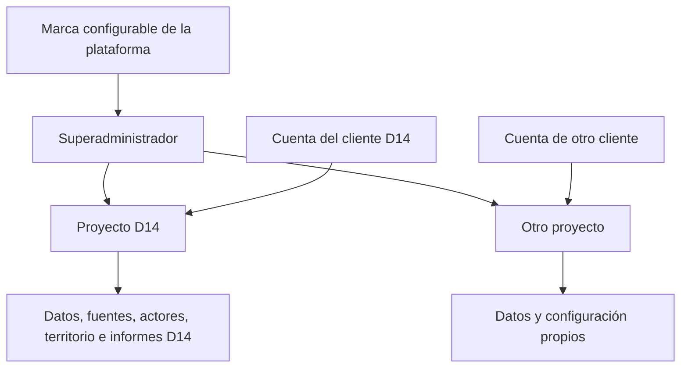

> **Pulso actualizado:** nueva composición de inicio; tono y emociones destacados; actores compactos; titulares por fecha y cuentas solo con seguidores/publicaciones/interacciones. Se retiraron las referencias de audiencia y el desplegable técnico al lector. Comparación histórica secundaria únicamente con datos y fechas. 131 pruebas del bloque y dos verificaciones finales con solapamiento; 262 comprobaciones JS. Revisión visual humana pendiente. Consulta NEXO_PULSO_REDISENO_GUIA.md o docs/PULSO_REDISENO.md. Las cifras de pruebas inferiores conservan el historial.

# NEXO · Pulso, proyectos y marca

Estado: 20 de octubre de 2026. Desarrollo local; nube anterior sin cambios. Este documento es el punto de entrada vigente para esta entrega.

## Lo que significa «una plataforma, varios proyectos»

La marca de la plataforma es común y editable. Cada proyecto tiene un nombre, contexto territorial, actores públicos, fuentes, archivos, publicaciones, capturas de cuentas, reglas, revisiones e informes propios. Distrito 14 es el primer proyecto; sus fuentes e históricos no son una plantilla que se copie a otros clientes.

Una cuenta puede recibir una o varias membresías. Una cuenta asignada únicamente al D14 solo consulta ese proyecto, en todas sus pestañas. El selector no muestra proyectos ajenos; escribir su identificador en una dirección tampoco concede acceso. Los datos y las operaciones se verifican nuevamente en el servidor.

El propietario de plataforma es una autorización independiente del rol «administrador de proyecto». Tiene acceso completo a los proyectos activos mediante membresías administrativas registradas. Los proyectos nuevos creados en la consola incorporan a los propietarios activos automáticamente. Una cuenta creada en la consola no recibe permisos hasta asignarle una membresía.

## Entrar y revisar

1. En la ventana del servidor del puerto 8002, usa Ctrl+C. Abre de nuevo `ABRIR_NEXO_DESARROLLO_LOCAL.bat` desde outputs.
2. Actualiza `http://127.0.0.1:8002` y usa tu cuenta LOCAL habitual. La cuenta local existente `admin@nexo.local` tiene ahora la autorización explícita de superadministrador. La contraseña se conserva.
3. Pulso inicia en datos reales del archivo local. Sin importaciones de redes aparecerán ceros de volumen y guiones donde falta información. Las 20 noticias y 45 secciones históricas permanecen en sus módulos.
4. «Ver demostración» prepara datos ficticios solo al pulsarlo. Se separan por proyecto y modo; un aviso visible acompaña las cifras. «Volver a datos reales» recupera el archivo real.
5. En Superadministración puedes cambiar la marca, crear una cuenta, crear un proyecto y asignar sus membresías. No hace falta crear otro programa para el siguiente cliente.

La marca cambia en el acceso, la barra lateral y el título del navegador. Nombres técnicos, exportaciones históricas, carpetas y direcciones anteriores conservan sus identificadores. El dominio y otros materiales de marca se cambian al preparar la publicación.

## Roles locales

| Cuenta / rol | Alcance |
|---|---|
| Superadministrador explícito | Todos los proyectos activos; marca, cuentas y membresías; acceso administrativo a cada proyecto |
| Administrador de proyecto | Su proyecto; actores, configuración y reglas; importación, revisión e informes |
| Editor | Su proyecto; preparación de Pulso; importación, revisión e informes; habilitar versiones para lectores |
| Consultor / analista | Su proyecto; consultar, importar, clasificar manualmente y redactar informes; sin gestión global ni reglas |
| Lector | Su proyecto; lectura y versiones de informes habilitadas; sin importaciones ni configuración |

No existe un botón web para darse permiso de propietario. Para recuperación administrativa local, el script `scripts/provision_platform_local.py` acepta una base SQLite existente, correo y `--grant` o `--revoke`. La revocación restaura los roles anteriores y elimina membresías añadidas por esa concesión; no borra membresías administrativas que ya existían. Si se crean proyectos fuera de la consola, se debe repetir la concesión para sincronizar su acceso. Es un procedimiento del propietario, no del cliente.

## Catálogo completo por proyecto

| Pestaña | Estado real de esta entrega |
|---|---|
| Pulso | Filtros por actor, periodo y canal; cálculos persistentes, cobertura, titulares y capturas; Apify apagado |
| Briefing | Resumen del archivo y accesos a evidencia e informes; no síntesis generativa automática |
| Actores | Directorio de actores públicos del proyecto; principal y comparativos configurables en Pulso |
| Territorio | D14 conserva mapa e histórico de 2024; otros proyectos muestran estado vacío hasta validar su conjunto y mapa |
| Redes | Lectura de capturas de la cuenta principal; consultas de otros actores desde Pulso; sin actualización automática |
| Fidelidad | Reservada; pendiente definir continuidad agregada de conversación. Sin perfiles de lealtad política individual |
| Alertas | Reglas evaluadas en el corte de últimas 24 h; sin notificaciones ni ciclo de incidentes persistente todavía |
| Explorador | Noticias y fuentes locales con filtros, búsqueda, revisión y resumen documental |
| Reportes | Versiones con fuentes congeladas, revisión y habilitación para lectores; descarga JSON |
| Auditoría de cuentas | Calidad de capturas de cuentas públicas: fechas y campos faltantes. Sin detección de bots o autenticidad implementada |

Biblioteca, revisión y carga de fuentes siguen disponibles como herramientas del proyecto. Que una pestaña exista no implica que todas sus funciones futuras estén terminadas.

## Cómo se calcula Pulso

La unidad es una **mención de un actor público en una publicación**. Una publicación sobre dos actores cuenta una mención para cada uno. No se guarda un padrón de comentaristas. El contenido libre puede contener nombres: debe revisarse y minimizarse antes de importarlo.

- **Menciones:** pares publicación–actor únicos, mismo proyecto, modo, canal y periodo. La reimportación de una publicación no duplica sus menciones. Puede actualizar sus contadores observados conservando el título y texto originales.
- **Parte de la conversación:** menciones del actor divididas por las menciones de todos los actores monitoreados activos del proyecto, con idéntico periodo y canal. Es participación del corpus observado, no de todas las redes ni de la población.
- **Índice de tono:** `(favorables + 0.5 × neutrales) / clasificadas × 100`. Por defecto exige 20 menciones clasificadas; el mínimo configurable es 3–1000. Se muestra cobertura y cantidad clasificada.
- **Contra su promedio:** diferencia en puntos frente al índice agregado de los 90 días anteriores al inicio del corte. Ambos cortes necesitan muestra suficiente. No es un cambio de intención de voto.
- **Emociones:** distribución de etiquetas revisadas entre las menciones con emoción, con el mínimo de cobertura; no emociones atribuidas a ciudadanos.
- **Alertas activas:** reglas cuyo umbral se alcanza en el corte. Las no evaluables no se convierten en «cero riesgo». El aumento de volumen compara con el periodo inmediatamente anterior de igual duración.
- **Titulares:** vistas observadas cuando la fuente las proporciona; después, fecha. Las vistas no son alcance único. El archivo RSS no aporta audiencia: se muestra como archivo por fecha y no como «mayor alcance».
- **Cuentas:** capturas por red y URL. Seguidores no se suman entre redes. Crecimiento requiere captura previa al periodo y captura nueva dentro de él. Fechas y periodo de métricas se declaran; valores ausentes permanecen desconocidos.

Ventanas de tiempo con inicio incluido y fin excluido, de 1 minuto a 90 días. El rango personalizado incluye el último día elegido usando la zona horaria del navegador. Las comparaciones usan el mismo filtro de canal.

## Cargar información local

En Pulso, abre «Preparación y datos del proyecto». Registra primero los actores públicos y anota sus identificadores devueltos por `/api/projects/ID/pulse/config`. La configuración no importa nombres o territorios de otro cliente.

Usa `NEXO_Local_D14/examples/pulse-import.template.json` como formato, sustituyendo actor y datos por información autorizada. El archivo es una plantilla ficticia, no medición del D14. El lote acepta de 1 a 500 publicaciones y hasta 2 MB. No acepta etiquetas de tono desde el archivo: se revisan manualmente en el módulo. El lector puede consultar; los roles de escritura importan y revisan.

Una exportación de Apify requiere un mapeo explícito de sus campos. `scripts/normalize_apify_export.py` normaliza archivos ya guardados; no descarga ni ejecuta un Actor. El mapa de ejemplo usa campos simples declarados. No se asume que dos Actors tengan el mismo esquema ni que una publicación mencione a todos los actores: el responsable del lote declara solo los actores realmente mencionados.

El endpoint de sincronización rechaza la operación. La configuración exige `enabled=false` y presupuesto 0. No guarda tokens, ni los busca para activar una conexión. Los iniciadores descartan variables heredadas de Apify e IA del proceso local.

La API oficial de Apify permite leer datasets con paginación; cada Actor deberá evaluarse por sus permisos, cobertura y formato antes de conectarlo. Referencias: [API y datasets](https://docs.apify.com/api/v2/getting-started), [almacenamiento de datasets y autenticación](https://docs.apify.com/storage/dataset), [uso y recursos](https://docs.apify.com/actors/running/usage-and-resources).

## Seguridad y comprobación

- SQLite privado fuera del ZIP. Nuevas tablas agregadas sin reescribir las filas anteriores; respaldo antes y después.
- Separación compuesta de proyecto y modo real/demo en publicaciones, menciones, cuentas y reglas. Identificadores ajenos se rechazan aunque se envíen directamente.
- Roles verificados en cada ruta; sin autoconcesión de superadministración; no se devuelve el hash de contraseñas. Contraseñas nuevas se capturan en el formulario local y se guardan con hash.
- Control de versiones al editar configuración, actores y clasificaciones. Respuestas tardías se descartan al cambiar de proyecto; se impide cambiar durante un guardado. Se limpian resultados y formularios del proyecto anterior.
- URLs HTTPS públicas sin credenciales ni tokens en parámetros reconocidos. El importador no las solicita. Para una conexión futura deben aplicarse además resolución DNS pública, conexión fijada, límites y rechazo de redirecciones, como en el RSS existente. Validar una URL guardada no sustituye estos controles de conexión.
- Límites locales: 50 actores reales por proyecto, 500 publicaciones por lote, 2 MB por lote, 100 revisiones en la lista, hasta 1000 capturas históricas y 20 cuentas por consulta con aviso si se acota. No equivale a cuotas mensuales de almacenamiento: faltan retención, cuotas por cliente y métricas operativas completas.
- RLS y permisos SQL de la migración futura 005 ensayados en PostgreSQL WASM. El rol web no puede modificar permisos de plataforma, marca, identidades o históricos. El control administrativo se implementó **solo en local**: su servicio privilegiado de nube sigue pendiente.
- Copia cifrada DPAPI y recuperación aislada en este perfil Windows. No sustituye un respaldo externo recuperable en otro equipo.
- No se modificaron `app/main.py` ni `app/knowledge.py`. La nueva vista todavía requiere aceptación humana en navegador; no se declara validación visual automática ni producción.

## Secuencia siguiente

1. Aceptar Pulso y el cambio entre un proyecto nuevo vacío y D14, con una cuenta de cliente de prueba.
2. Completar Briefing y los recorridos particulares de Redes, Alertas y auditoría; definir la continuidad agregada; extracción PDF/XLSX y evaluación de evidencia.
3. Incorporar fixtures del Actor de Apify que se elija, cuotas por proyecto, retención, cobertura y evaluación de etiquetas. Conectar una fuente autorizada por vez al finalizar.
4. Preparar publicación con identidad de nube, MFA, control administrativo separado, migraciones, pruebas nativas de PostgreSQL/RLS, TLS, respaldo externo, monitoreo y presupuesto explícito.

El piloto podrá convertirse en el primer proyecto operativo tras esas validaciones. La arquitectura reduce trabajo repetido; no garantiza que proveedores, permisos y todas las pruebas finales puedan resolverse en un solo día.
